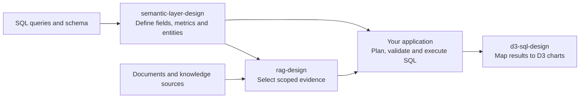

# Build agentic analytics with Claude Code

Three Claude Code skills for designing analytics agents that retrieve scoped evidence, use explicit field and metric definitions, and turn SQL results into D3 charts.

[Install and use the skills](CLAUDE.md)

A one-off SQL prompt or a standalone chart leaves important connections for you to define: what a field means, which evidence supports an answer, and whether a filter or rollup changes a metric. This kit helps you specify those connections before implementing them in your application.

The repository contains design guides, schemas, prompt templates and executable synthetic examples. Your application supplies the ingestion, retrieval, SQL execution and chart runtime.

## Connect evidence, meaning and charts

The diagram shows one application architecture these skills can help you design. Each skill can also be used on its own.



| Skill | Use it to build | Make the handoff explicit |
| --- | --- | --- |
| [semantic-layer-design](.claude/skills/semantic-layer-design/SKILL.md) | A field catalog for text-to-SQL, entity lookup or portable context. | Field meanings, metric populations and grain, reviewed definitions, generation readiness and consumer projections. |
| [rag-design](.claude/skills/rag-design/SKILL.md) | Document search, dataset navigation or an assistant that cites its evidence. | Source and evidence identities, lexical/hybrid selection, scope, ambiguity, citations and publication states. |
| [d3-sql-design](.claude/skills/d3-sql-design/SKILL.md) | A SQL-to-D3 pipeline with defined behavior when a user changes the view. | Metric arithmetic, exact result aliases, row grain, chart preparation, reuse versus requery, and resource disposal. |

For example, a regional average needs its sum and count when regions are combined. A result column named `net_revenue` needs an explicit mapping to its chart label. These are contracts to preserve and test, rather than choices left to the renderer.

## Try one bounded task

Install the complete skill folders, open Claude Code in your application repository, and give the selected skill real inputs and a concrete outcome.

```text
/semantic-layer-design Design a semantic catalog for our orders query. Define customer_id, ordered_at and net_revenue, including grain, currency, null handling and reviewed overrides. Identify missing evidence before proposing storage changes.
```

```text
/rag-design Design retrieval for our support articles. Specify citable units, document revisions, lexical and vector selection, access filtering, and distinct no-hit and dependency-failure states.
```

```text
/d3-sql-design Design monthly net revenue by region from our approved field catalog. Define SQL output aliases, row grain and chart bindings. Explain when a filter change requires a new query, and how the chart disposes its resources.
```

The [use guide](CLAUDE.md#combine-the-skills-around-one-consumer) explains how to carry the contracts between skills. The examples demonstrate selected deterministic contracts; they do not establish your application's SQL safety, retrieval quality or browser behavior.

## Find the files you need

```text
claude-skills-rag-semantic-d3-analytics/
├── README.md
├── CLAUDE.md
├── AGENTS.md
├── FILES.md
├── .gitignore
└── .claude/
    └── skills/
        ├── semantic-layer-design/
        │   ├── SKILL.md
        │   ├── references/
        │   ├── assets/
        │   └── scripts/
        ├── rag-design/
        │   ├── SKILL.md
        │   ├── references/
        │   ├── assets/
        │   └── scripts/
        └── d3-sql-design/
            ├── SKILL.md
            ├── references/
            ├── assets/
            ├── scripts/
            └── requirements.txt
```

Each `SKILL.md` routes to the references needed for your task. [FILES.md](FILES.md) lists every shipped file. The [installation and use guide](CLAUDE.md) covers personal and project-local installation, optional example checks and maintenance. [Claude Code's skill documentation](https://code.claude.com/docs/en/skills) explains native discovery and invocation.
